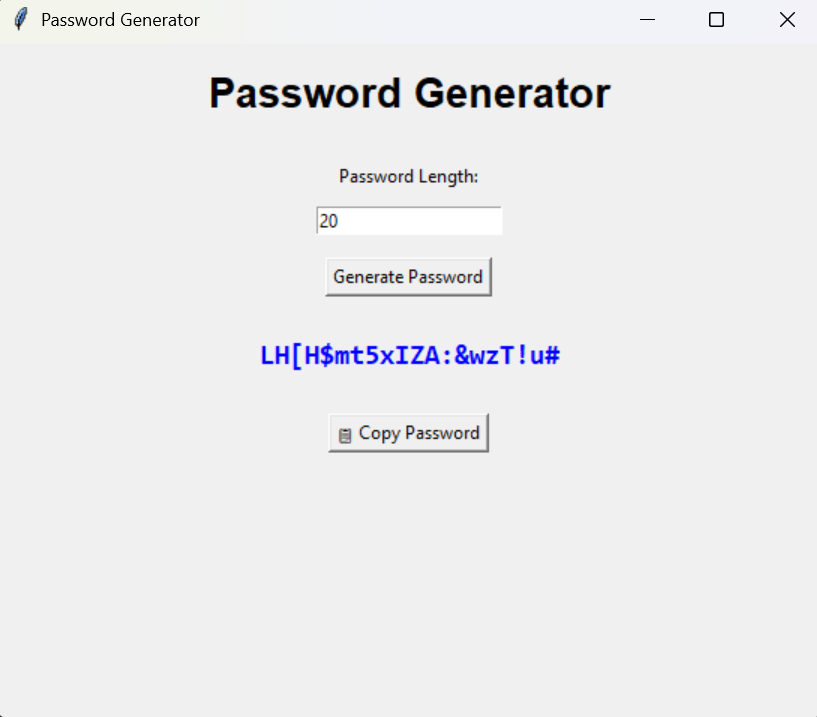

#  Password Generator

A simple password generator built with Python and Tkinter.

I made this project to practice Python fundamentals and learn how to build desktop applications with Tkinter. It generates random passwords based on the length entered by the user and includes a copy button for convenience.

## Features

* Generate random passwords
* Choose the password length
* Includes:

  * Uppercase letters
  * Lowercase letters
  * Numbers
  * Symbols
* Copy the generated password to the clipboard
* Simple and easy-to-use interface

## Built With

* Python
* Tkinter

## Getting Started

1. Clone the repository:

```bash
git clone https://github.com/YOUR_USERNAME/Password-Generator.git
```

2. Go to the project folder:

```bash
cd Password-Generator
```

3. Run the program:

```bash
python app.py
```

## What I Learned

While building this project, I learned how to:

* Build a GUI using Tkinter
* Work with functions and loops
* Generate random values using Python
* Use Python's `string` module
* Update widgets dynamically
* Copy text to the system clipboard

## Future Improvements

Some features I'd like to add in the future:

* Password strength indicator
* Option to choose which character types to include
* Dark mode
* Save password history


## Screenshot




